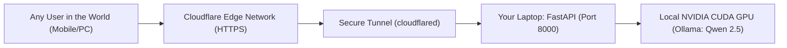
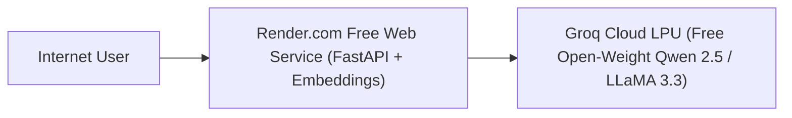

# 🚀 DocuLens Enterprise RAG: Free Hosting & Deployment Blueprint

---

## 1. Where Will the Model Run? (The Big Picture)

A production RAG application has two primary workloads:

| Workload | What it Does | Hardware Needed | Best Free Hosting Location |
| :--- | :--- | :--- | :--- |
| **Tier 1: Web App & Retrieval Engine** | FastAPI Server, HTML/Tailwind Frontend, SQLite Auth DB, FastEmbed Embeddings (`BGE-small`), Cross-Encoder Reranker | ~500 MB – 1 GB RAM, standard CPU | **Render Free Tier**, **Hugging Face Spaces**, or **Railway** |
| **Tier 2: The Large Language Model (LLM)** | Qwen 2.5 / LLaMA 3.2 synthesis & discrepancy detection | GPU or high-speed LPU | **Option A**: Your local NVIDIA GPU (via Cloudflare Tunnel)  <br>**Option B**: Groq Cloud Free API (Open-Weight Qwen/Llama at 500+ t/s) |

---

## 2. The 3 Best 100% Free Deployment Methods

---

### 🌟 Method 1: Instant Public URL via Cloudflare Tunnel (Best for Portfolio & Client Demos)

This method keeps **Qwen 2.5 running on your local NVIDIA GPU via Ollama** for free, while exposing your web application to a secure, public HTTPS URL that anyone worldwide can open on their phone or browser.



#### Steps to Deploy in 2 Minutes:
1. **Download Cloudflare's free tunnel client** (`cloudflared`):
   ```powershell
   # In PowerShell:
   winget install Cloudflare.cloudflared
   ```
2. **Start your DocuLens app locally**:
   ```powershell
   cd d:\RAG
   py -3.10 app.py
   ```
3. **Open the tunnel**:
   ```powershell
   cloudflared tunnel --url http://127.0.0.1:8000
   ```
4. **Result**: Cloudflare gives you a free public link:
   ```text
   +-----------------------------------------------------------------------+
   |  Your quick Tunnel has been created! Visit it at:                    |
   |  https://doculens-enterprise-demo.trycloudflare.com                   |
   +-----------------------------------------------------------------------+
   ```
*✅ 100% Free, zero cloud setup, keeps your local GPU active, and anyone can test your live app.*

---

### ☁️ Method 2: 100% Cloud Hosting on Render (Laptop Can Be Turned Off)

If you want the web app to run 24/7 even when your laptop is turned off, deploy the web app to **Render** and use **Groq's 100% Free Open-Weight Tier** for the LLM.



#### Why Groq for the Model?
- **100% Free**: No credit card required.
- **Open-Weight**: Hosts official open-weight models (`qwen-2.5-32b`, `llama-3.3-70b-versatile`, `llama-3.2-3b-preview`).
- **Blazing Speed**: Generates 500+ tokens/second (10x faster than local laptops).

#### Step-by-Step Guide:
1. **Get a Free Groq API Key**:
   - Go to [console.groq.com](https://console.groq.com) $\rightarrow$ Sign in $\rightarrow$ Click **API Keys** $\rightarrow$ **Create API Key**.
2. **Push your code to GitHub**:
   ```powershell
   cd d:\RAG
   git init
   git add .
   git commit -m "DocuLens Enterprise RAG with RBAC"
   git remote add origin https://github.com/<your-username>/doculens-rag.git
   git push -u origin main
   ```
3. **Deploy on Render**:
   - Go to [render.com](https://render.com) and click **New Web Service**.
   - Connect your GitHub repository `doculens-rag`.
   - Configure:
     - **Runtime**: `Python 3` (or `Docker`)
     - **Build Command**: `pip install -r requirements.txt`
     - **Start Command**: `uvicorn app:app --host 0.0.0.0 --port $PORT`
     - **Instance Type**: `Free`
   - Under **Environment Variables**, add:
     - `GROQ_API_KEY`: `<your_free_groq_api_key>`
     - `GROQ_MODEL`: `qwen-2.5-32b` (or `llama-3.3-70b-versatile`)
4. **Click Deploy**:
   - Render builds the container and gives you a free live URL: `https://doculens-rag.onrender.com`.

---

### 📦 Method 3: Hugging Face Spaces (Free Docker Container with 16GB RAM)

Hugging Face Spaces offers a **100% Free CPU Tier with 16 GB RAM and 2 vCPUs** permanently:

1. Go to [huggingface.co/spaces](https://huggingface.co/spaces) $\rightarrow$ Click **Create new Space**.
2. Space SDK: Select **Docker** (Blank).
3. Set Space hardware: **Free (2 vCPU, 16 GB RAM)**.
4. Push your `Dockerfile`, `app.py`, `requirements.txt`, `static/`, and `src/` to it.
5. In Space Settings $\rightarrow$ **Repository Secrets**, add:
   - `GROQ_API_KEY`: `<your_free_groq_api_key>`
6. Hugging Face builds your Docker container automatically and serves your app on `https://huggingface.co/spaces/<your-name>/doculens-rag`.

---

## 3. Comparison of Free Hosting Options

| Dimension | Method 1: Cloudflare Tunnel | Method 2: Render + Groq | Method 3: Hugging Face Spaces |
| :--- | :--- | :--- | :--- |
| **Setup Time** | **2 minutes** | 5 minutes | 5 minutes |
| **Laptop Needs to Be On?** | Yes (uses your local GPU) | **No (100% Cloud 24/7)** | **No (100% Cloud 24/7)** |
| **LLM Inference Location** | Local NVIDIA GPU (Ollama) | Groq Cloud LPU ($0) | Groq Cloud LPU or Local CPU |
| **Cost** | **$0.00** | **$0.00** | **$0.00** |
| **Credit Card Required?** | **None** | **None** | **None** |
| **Speed** | 15–30 tokens/sec | **500+ tokens/sec** | 500+ tokens/sec |
| **Best For** | Live interviews & rapid testing | Permanent portfolio link | Open-source community showcase |
