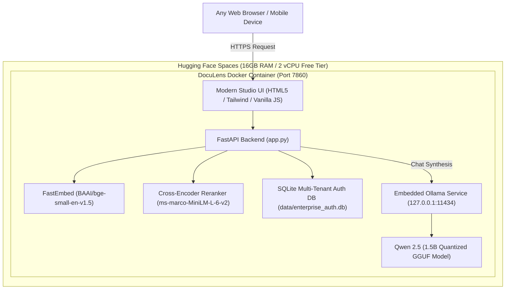

# 🚀 DocuLens Enterprise RAG: Cloud Deployment Guide
### 100% Free Hosting • Embedded Model • Zero API Keys • Zero Laptop Hardware

---

## 🎯 The Core Problem & Solution

| Question / Constraint | The Solution |
| :--- | :--- |
| **"Model will not run on my laptop"** | The model runs **100% inside the cloud container**. You can turn off your laptop completely. |
| **"No API keys"** | Zero OpenAI, Anthropic, or Groq API keys required. We use **open-weight Qwen 2.5 (1.5B)** running locally on CPU inside the Linux container. |
| **"How can I host it for free?"** | **Hugging Face Spaces (Free Docker Tier)** provides **16 GB RAM, 2 vCPUs, and 50 GB storage** permanently for **$0.00** without a credit card. |
| **"Where will the model run?"** | Inside the Docker container, `start.sh` boots an embedded Linux **Ollama daemon** which serves `qwen2.5:1.5b` directly to FastAPI on internal port `11434`. |

---

## 🏗️ Architecture: Self-Contained Cloud Container



---

## 📋 Step-by-Step Deployment Instructions

### Step 1: Create a Free Hugging Face Account
1. Visit [huggingface.co/join](https://huggingface.co/join) and create a free account (if you don't already have one).
2. No credit card is required.

---

### Step 2: Create a New Space
1. Go to [huggingface.co/spaces](https://huggingface.co/spaces) and click **"Create new Space"** (or click the plus icon on your profile).
2. Fill in the fields:
   - **Space Name**: `Doculens`
   - **License**: `mit` (or `apache-2.0`)
   - **Space SDK**: Select **`Docker`** $\rightarrow$ choose **`Blank`**.
   - **Space Hardware**: Keep **`Free (2 vCPU, 16 GB RAM)`**.
   - **Visibility**: `Public` (recommended so others can test your app).
3. Click **"Create Space"**.

---

### Step 3: Link Your GitHub Repository to the Space

There are two easy ways to deploy your code to the Space:

#### Option A: One-Command Git Push from Your Terminal (Recommended)
Hugging Face Spaces gives you a Git URL for your Space:
```bash
# In your terminal (inside d:\RAG):
# 1. Add your Hugging Face space as a secondary git remote
git remote add hf https://huggingface.co/spaces/<YOUR_HF_USERNAME>/Doculens

# 2. Push directly to Hugging Face
git push hf main
```
*(When prompted for credentials, use your Hugging Face username and your HF Access Token from [huggingface.co/settings/tokens](https://huggingface.co/settings/tokens) as the password).*

#### Option B: Automatic Sync from GitHub
1. In your Hugging Face Space, click **Settings**.
2. Scroll to **"GitHub Actions"** or clone the repository to the Space.

---

### Step 4: Watch the Container Build & Run
1. In your Space's **"App"** or **"Logs"** tab, you will see the build log:
   - Installing Python dependencies (`fastapi`, `fastembed`, `pyjwt`, `pdfplumber`).
   - Installing Linux Ollama CLI.
   - `start.sh` boots `ollama serve`.
   - `start.sh` downloads `qwen2.5:1.5b` (takes ~15-20 seconds in HF's high-speed datacenter).
   - `uvicorn app:app --port 7860` starts.
2. The status indicator turns from **Building** $\rightarrow$ **Running**!
3. Your live application will appear directly at:
   `https://huggingface.co/spaces/<YOUR_HF_USERNAME>/Doculens`

---

## 🔐 Multi-Tenant Login Credentials for Testing

Once deployed, anyone can access your live link:
- **Auditor Persona (1-Click Demo)**:
  - Username: `auditor`
  - Password: `auditor123`
  - Scope: Permitted to view and audit all Legal & Financial contracts/invoices (`MSA_Acme_Cyberdyne_2024.pdf`, `INV_2024_081_Compliant.pdf`, etc.).
- **Regular User (Public Self-Registration)**:
  - Anyone can click **"Create an Account"**.
  - All new public accounts are strictly locked to the role `user`.
  - Zero cross-tenant data leakage: Regular users only see their own uploaded documents.
- **Admin Persona**:
  - Username: `admin`
  - Password: `admin123`
  - Scope: Complete platform governance and access to all enterprise documents.

---

## ⚡ Summary of Why This Setup Is Ideal

| Feature | DocuLens Cloud Implementation |
| :--- | :--- |
| **Cost** | **$0.00 / Month** (Hugging Face Free Tier) |
| **API Keys** | **None** (Self-contained open-weight model) |
| **Hardware Required** | **Zero laptop dependency** (Runs 24/7 on HF Cloud CPU) |
| **Model Size** | `qwen2.5:1.5b` (~980 MB disk, ~1.2 GB RAM footprint) |
| **Available RAM on HF** | **16 GB RAM** (Plenty of headroom for embeddings + model) |
| **Persistence** | Embedded SQLite DB for user accounts and documents |
